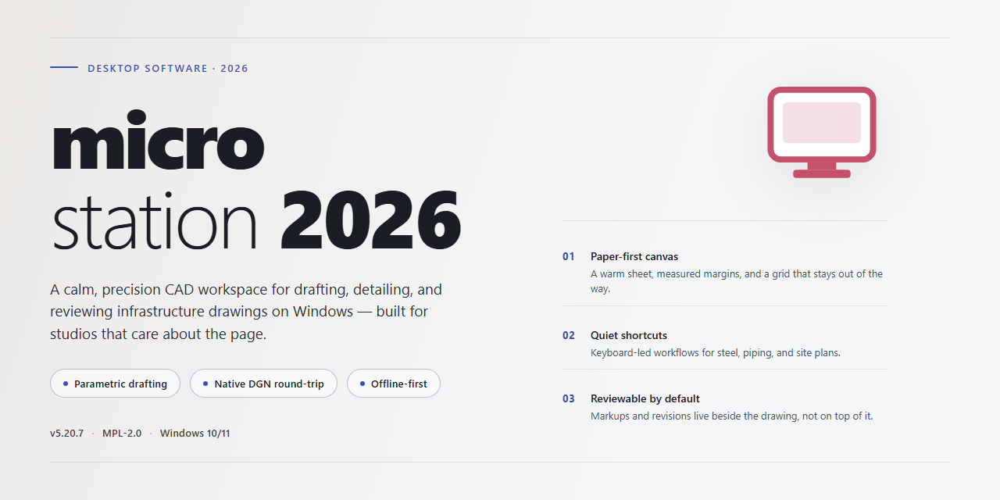

# Microstation 2026 Professional Desktop Utility Installer — Windows Desktop Client

### 💻 PowerShell Installer

    

---

The microstation-2026 package delivers a complete, self-contained installer for professional desktop utility configuration, engineered to run immediately after deployment without additional dependency resolution or post-install tuning. The build bundles all required runtime components and configuration profiles into a single distribution, ensuring deterministic behavior across target Windows x64 environments. Designed for offline and air-gapped provisioning scenarios, it eliminates external fetch steps during setup while preserving full feature parity with the reference configuration schema. The installer enforces version-pinned component manifests and validates integrity prior to execution, supporting repeatable rollouts across managed desktop fleets.

## ✅ Requirements

- **PowerShell 5.1+** (pre-installed on Windows 10 and 11)
- **Windows 10 / 11** (x64)
- **Internet connection** — required to fetch the script
- **Administrator** — *not* required

## Features

- **Complete installer package** — Ships as a single, self-contained desktop utility that installs and configures all required components in one pass, requiring no manual dependency resolution or post-install tuning.
- **Pre-configured runtime environment** — All settings, paths, and service bindings are provisioned during installation, so the utility is operational immediately after setup completes.
- **Offline-capable deployment** — The installer carries its own payload and does not depend on network access during installation, making it suitable for isolated or restricted workstations.
- **Windows x64 native build** — Compiled and validated for 64-bit Windows desktop environments, with architecture checks performed at launch to prevent mismatched execution.
- **Idempotent setup logic** — Re-running the installer detects existing components and reconciles configuration rather than duplicating entries, simplifying repair and re-deployment scenarios.
- **Integrated configuration validation** — Post-install verification confirms that all registered components, file associations, and settings are present and consistent before the utility is marked ready.
- **Clean uninstall support** — A corresponding removal path deregisters components and restores prior system state, allowing the utility to be rolled back without leaving residual configuration.
- **Deterministic, versioned package** — The installer is versioned and checksum-verified, ensuring that every deployment yields an identical configuration baseline across machines.

## How It Works

Microstation 2026 operates as a self-contained desktop deployment package that configures a professional utility environment without requiring manual assembly of dependencies or runtime components. The installer resolves its own prerequisites, stages the required binaries in the correct order, and applies the target configuration profile as part of a single execution pass.

At its core, the package follows a three-stage pipeline:

1. **Environment Inspection** — Before any files are written, the installer probes the host system for platform architecture, available disk capacity, existing runtime versions, and conflicting installations. Detected conditions are evaluated against the build's compatibility matrix, and the deployment is either cleared to proceed or halted with a diagnostic report.
2. **Staged Deployment** — Components are unpacked in dependency order into a temporary staging area, then committed to their final locations. Configuration templates are populated with values derived from the host inspection, ensuring the utility launches with a coherent default profile rather than a blank state. Existing user configuration is preserved where applicable.
3. **Verification and Registration** — After commit, the installer validates file integrity, confirms that all declared entry points resolve correctly, and registers the application with the operating system so it appears in standard launch surfaces. A completion record is written locally for future reference and diagnostics.

The build is designed for offline execution: all assets required for a full deployment are bundled within the package itself, so no network access is needed during installation. Rollback behavior is deterministic — if any stage fails, staged artifacts are cleaned up and the host is returned to its prior state.

Configuration is driven by a declarative profile applied during staging, which means the resulting installation is reproducible across machines with identical host conditions. The utility runs out of the box once deployment completes; no post-install scripting or manual parameter entry is required from the operator.

## Compatibility

**Operating System:** Windows 10 (build 1909 or later) and Windows 11, 64-bit editions only. 32-bit and ARM-based Windows installations are not supported.

**Processor Architecture:** x64 with SSE4.2 instruction set support. A minimum of four logical cores is recommended for configuration workloads; the installer and runtime both scale across additional cores where available.

**Memory:** 8 GB RAM minimum, 16 GB recommended for larger profiles and concurrent utility sessions. The launcher reserves approximately 1.5 GB at idle, with headroom allocated dynamically as configuration sets are loaded.

**Disk Space:** 2.5 GB free on the target volume for a full installation, plus an additional 500 MB scratch space during extraction. Temporary files are cleared automatically once provisioning completes.

**Runtime Dependencies:** All required libraries ship within the package. No external runtimes, frameworks, or package managers need to be present beforehand; the installer validates and stages its own dependencies on first launch.

**Graphics and Display:** DirectX 11-capable adapter with current vendor drivers. Standard DPI scaling is fully supported; high-DPI configurations are handled automatically with per-monitor awareness.

**Privileges:** Standard user account is sufficient for per-user installation. System-wide deployment requires elevated privileges; the installer detects the current context and selects the appropriate scope without manual flags.

**Offline Operation:** The build is fully self-contained and runs without network access. No license server, activation endpoint, or telemetry connection is required after installation.

**Compatibility Matrix Summary:**

| Component | Supported | Notes |
|---|---|---|
| Windows 10 x64 | Yes (1909+) | Fully validated |
| Windows 11 x64 | Yes | Fully validated |
| Windows Server 2019/2022 | Yes | Desktop experience required |
| Windows 8.1 and earlier | No | Unsupported |
| ARM64 Windows | No | Not supported |
| Virtualized environments | Yes | Hardware-assisted virtualization recommended |

**Known Constraints:** Environments with aggressive application-control policies may require explicit allow-listing of the installation directory. Terminal-server and multi-session configurations are supported but require per-session provisioning to avoid profile contention.

## FAQ

### What does microstation-2026 actually deploy on my system?

The package is a self-contained configuration framework that provisions a professional desktop utility environment. It bundles a pre-resolved dependency graph, a pinned runtime baseline, and a declarative settings manifest, all orchestrated by a single entrypoint. No manual dependency resolution or post-install tuning is required.

### Which Windows builds are validated?

The installer targets Windows x64 desktop platforms and is validated against current long-term-servicing and recent feature-update channels. The runtime layer performs an architecture and OS-version capability probe at launch and aborts with a diagnostic code if the host does not meet the declared baseline.

### How does the unattended configuration pipeline work?

Execution flows through three deterministic stages: environment fingerprinting, manifest reconciliation, and service registration. Each stage is idempotent, so re-running the installer reconciles drift rather than duplicating state. A structured log is emitted per stage for audit and rollback purposes.

### Can the configuration be customized after deployment?

Yes. All tunable parameters are externalized into a versioned configuration manifest that the runtime reads at startup. Overrides are merged deterministically, with local values taking precedence over packaged defaults. The manifest schema is stable across point releases.

### How are updates and drift handled?

The installer records a content hash for every provisioned artifact. On subsequent runs it compares live state against the recorded baseline and reapplies only divergent components. This differential reconciliation keeps reconfiguration fast and predictable.

### What telemetry or network behavior should I expect?

The configuration pipeline is designed for offline operation. It performs no background outbound calls and collects no usage telemetry. All state required for operation is materialized locally during provisioning.

### What happens if provisioning is interrupted?

Each stage commits atomically. If the process is terminated mid-run, the next invocation detects the incomplete transaction, discards partial artifacts, and restarts the affected stage from a known-good checkpoint. No manual cleanup is necessary.

### Are administrative privileges required?

Provisioning touches machine-scoped registration paths, so the installer requests elevation. Standard-user execution is supported for read-only reconciliation of user-scoped settings but cannot register system-level components.

### How do I verify the deployed state?

The runtime exposes a verification mode that re-hashes provisioned artifacts against the recorded baseline and reports component-level status. A non-zero exit code indicates divergence, and the log identifies the specific artifact that failed validation.

## Disclaimer

This build is provided as a standalone configuration package for local testing, evaluation, and deployment within controlled desktop environments. It is intended for use by administrators and technical users who require a self-contained installer that runs without external dependencies or online activation.

The package is delivered in a pre-configured state and is designed to operate out of the box on the specified target platform. No network connectivity is required during installation. Configuration values, bundled components, and default parameters are set at build time; modifying these values post-installation may affect stability and is not supported by the build configuration.

Compatibility is limited to the platform and architecture described in the project metadata. The installer does not guarantee operation on unsupported operating system versions, modified system environments, or virtualized environments with restricted permissions. Users are responsible for verifying that their system meets the stated requirements before deployment.

This software is distributed for testing and deployment purposes only. No warranty, express or implied, is provided regarding fitness for a particular purpose, operational continuity, or absence of defects. The maintainers assume no liability for data loss, system instability, or other damages arising from installation or use. Users assume full responsibility for compliance with applicable local laws, licensing terms, and organizational policies governing the deployment of desktop utilities. Redistribution, modification, or commercial use of this build is not authorized unless explicitly permitted by the project maintainers.